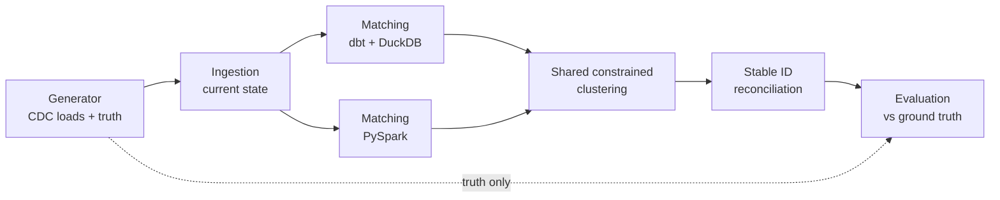

# Person Matching Pipeline

[](https://github.com/fredr171/person-matching-pipeline/actions/workflows/ci.yml)

**Entity resolution for healthcare records:** rule-based record linkage that builds a master
patient index (MPI) with stable person IDs from messy, incremental source data.
**Precision 0.992** on 128,000 synthetic records with known ground truth, and two independent
implementations whose outputs are identical across 27 million rows.
**Stack:** Python, dbt on DuckDB, PySpark, pandas/pyarrow, pytest, GitHub Actions.

## The problem

The same patient shows up in many source systems under slightly different identities: a typo
in the SSN, a nickname, a married name, a date of birth with month and day swapped. Some
look-alikes really are different people, such as twins, a father and son, or two people whose
records share an SSN. Merging them by mistake can put one patient's allergies on another
patient's chart.

## The approach

- A **synthetic data generator** produces monthly CDC loads with known ground truth and 60
  deliberately exaggerated edge cases ([catalog](docs/DATA_GENERATION.md)).
- **Tiered match rules plus cannot-link blockers** follow one principle: *at most one
  imperfect field per automatic match; when uncertain, don't merge*
  ([matching rules](docs/MATCHING_RULES.md)).
- **Constrained clustering** joins matched pairs into people, but never across a blocked pair.
- **Stable person IDs** survive rematching every load, and change only when the data does.
- **Matching runs twice**, in dbt on DuckDB and in PySpark, and the two must agree exactly.
- **Evaluation against ground truth** reports precision and recall, outcomes per edge case,
  and ID churn ([results](docs/RESULTS.md)).

## Results

Medium preset: 128,000 live records after 13 monthly loads. Precision and recall are pairwise,
over all pairs of records.

| Profile | Precision | Recall | Falsely merged records | ID churn per load |
|---|---:|---:|---:|---:|
| **conservative** (default) | 0.992 | 0.710 | 788 | 0.12% |
| balanced | 0.992 | 0.712 | 797 | 0.12% |
| aggressive | 0.974 | 0.906 | 2,982 | 0.08% |

*Balanced* only lowers the fuzzy name-score threshold, and on this data names nearly always
match exactly, as a known nickname or phonetically first, so it adds just 0.3% more matches.
The big lever is matching on name and DOB without an SSN, which only *aggressive* allows.

- **Precision holds; recall is the price.** 87% of the true pairs the conservative profile
  misses involve a record with no usable SSN or DOB (placeholders, ITINs, migration defaults).
  Matching those needs name and DOB alone, which only the aggressive profile allows.
- **Most remaining false merges cannot be fixed with five fields.** 720 of the 788 are
  full identity copies, identical strangers or near-copies of another identity.
- **ID changes are mostly corrections.** Over 90% of person ID changes move a record closer
  to the truth.
- **The engines agree exactly.** Every output table of every load is identical between dbt
  and PySpark, for all three profiles.

## Pipeline



## Quickstart

Requires Python 3.11+ and Java 17+. Runs locally; no cloud account.

```bash
python -m venv .venv && source .venv/bin/activate
make install
make generate                      # small preset: 13 monthly loads in a few seconds
make ingest                        # apply the CDC events to a current-state table
make match-dbt                     # match every load with dbt + DuckDB (about 1 minute)
make match-spark                   # the same matching in PySpark (a few minutes)
make compare-engines               # check every dbt and Spark output table is identical
make evaluate                      # score each load against ground truth
make test
```

Windows without `make`, Spark notes, reproducing the results and example queries:
[docs/RUNNING.md](docs/RUNNING.md).

## Key design decisions

Full reasoning for each is in the [decision log](docs/DESIGN.md#18-decision-log).

- **No human review queue.** An uncertain pair becomes a no-match with a reason code, so
  every decision is automatic and explainable.
- **Exact SSN and exact DOB need only one strong name**, so marriages and legal name
  changes still match.
- **Cannot-link blockers win over matches.** Twins, parent and child, conflicting suffixes
  and SSN conflicts are never merged, even through a chain of other matches. Clustering
  skips any join that would break one and records why.
- **Full rematch every load, with stable IDs.** Rematching from scratch picks up
  corrections automatically; reconciliation keeps each person's ID unless their cluster
  really splits or merges.
- **Conservative by default**, because in healthcare a false merge costs more than a
  duplicate.
- **Rules written once, checked three times.** A Python reference defines expected
  behaviour; dbt is tested against it and Spark against dbt, table by table. Clustering and
  string similarity are shared Python code, and reference data (nicknames, placeholders,
  name particles) is one set of CSV files read by every engine.
- **Ground truth is isolated.** Only evaluation and tests may read it, and a test fails if
  pipeline code refers to it.

## Known limitations

Some cases cannot be solved with five fields. Each is generated on purpose and measured
(conservative profile; [full table](docs/RESULTS.md#known-limitations-measured-conservative)):

| Case | What happens | Pair precision | Pair recall |
|---|---|---:|---:|
| Full identity copy (another person's records repeat all five values) | usually merged | 0.605 | 0.695 |
| Identical strangers (different people, same values) | usually merged | 0.588 | 0.700 |
| SSN replacement (new SSN issued) | the two SSNs stay apart | 0.992 | 0.460 |
| Full name change (first and last name at once) | about half stay apart | 1.000 | 0.746 |
| Mononym (one name, placeholder in the other field) | most stay apart | 1.000 | 0.568 |

Scale is untested beyond the medium preset: a 5-million-record preset is defined but was not
run, and the Spark run collects each output table on the driver, so driver memory bounds
the largest load it can write.

## Repository layout

| Path | Contents |
|---|---|
| `docs/` | [Design specification](docs/DESIGN.md) and decision log, data generation, matching rules, results, running |
| `config/` | `generator.yaml`, `matching.yaml`, and `reference/` data read by every engine |
| `generator/` | Synthetic population and CDC event generator |
| `ingestion/` | CDC events to current state |
| `standardization/` | Python reference rules: standardization, blocking, comparison, tiers, blockers |
| `matching_dbt/` | dbt project (DuckDB): the SQL implementation |
| `matching_spark/` | PySpark implementation |
| `clustering/` | Shared constrained clustering and stable ID reconciliation |
| `evaluation/` | Metrics against ground truth |
| `pipeline/` | Config and reference loaders, CLI, engine comparison |
| `tests/` | Unit, scenario, parity, idempotency and determinism tests |

## License

[MIT](LICENSE). All data is synthetic; no real people or SSNs appear anywhere in this
repository.
