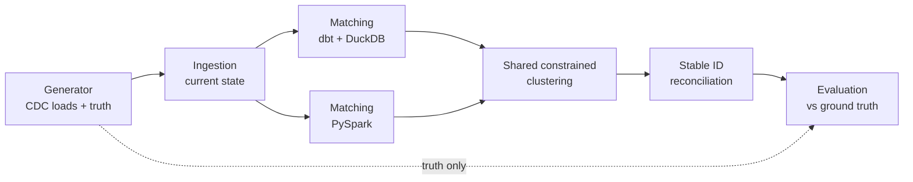

# Person Matching Pipeline

[](https://github.com/fredr171/person-matching-pipeline/actions/workflows/ci.yml)

**The problem.** The same person shows up in many source systems under slightly
different identities: a typo in the SSN, a nickname, a married name, a date of birth
with month and day swapped. Some look-alikes really are different people, such as
twins, a father and son, or two people whose records share an SSN. Merging them by mistake
can put one patient's allergies on another patient's chart.

**The approach.** This project builds a rule-based, fully automated person matching
pipeline. It is designed so that every decision can be explained and measured:

- A **synthetic data generator** produces incremental CDC loads with known ground
  truth and 60 deliberately exaggerated edge cases
  ([catalog](docs/DATA_GENERATION.md)).
- An **ingestion layer** turns raw CDC events into a clean current-state table.
- **Matching runs twice**, in dbt on DuckDB and in PySpark, and the two must give
  identical results.
- **Tiered rules plus cannot-link blockers** follow one principle: *at most one
  imperfect field per automatic match; when uncertain, don't merge*.
- **Stable person IDs** change only when the data justifies it.
- **Evaluation against ground truth** reports pairwise precision/recall, outcomes per
  edge case, and ID churn.

**Headline results** (medium preset: 128,000 live records after 13 monthly loads,
[full results](docs/RESULTS.md)): the default conservative profile reaches pairwise
**precision 0.992** at recall 0.710. The aggressive profile raises recall to 0.906 at
precision 0.974, with about four times as many falsely merged records. About 0.1% of
person IDs change per load, and over 90% of those changes move a record closer to the
truth. The dbt and PySpark implementations produce **identical output**: every table of
every load, 27 million rows across the three profiles.

## Pipeline



## Quickstart

Requirements: Python 3.11+, and Java 17+ for the PySpark implementation. No cloud
account is needed.

```bash
python -m venv .venv
source .venv/bin/activate          # Windows: .venv\Scripts\activate
make install                       # Windows without make: see below
make check-config
make generate                      # small preset: 13 monthly loads in a few seconds
make ingest                        # apply the CDC events to a current-state table
make match-dbt                     # match every load with dbt + DuckDB (about 1 minute)
make match-spark                   # the same matching in PySpark (local mode, a few minutes)
make compare-engines               # check every dbt and Spark output table is identical
make evaluate                      # score each load against ground truth
make test
```

Every `make` target wraps a Python command, so on Windows without `make` you can run:

```powershell
python -m pip install -r requirements-lock.txt
python -m pip install --no-deps -e .
python -m pipeline check-config
python -m pipeline generate --preset small
python -m pipeline ingest
python -m pipeline match-dbt --profile conservative
python -m pipeline match-spark --profile conservative
python -m pipeline compare-engines --profile conservative
python -m pipeline evaluate --profile conservative
python -m pytest
```

The PySpark run works on Linux, macOS and native Windows (no WSL or winutils: the driver
writes outputs with pyarrow, D-011, D-044). It takes about 25 seconds per small load, most of
it starting Python workers, which Windows cannot reuse (D-046). On a machine short of memory,
set `PMP_SPARK_DRIVER_MEMORY=1g` and `PMP_SPARK_MASTER=local[4]`. If a Spark run is killed rather
than left to finish, check for a leftover `java.exe`: on Windows the Spark JVM can outlive
the Python process that started it.

## Repository layout

| Path | Contents |
|---|---|
| `docs/` | [Design specification](docs/DESIGN.md) (source of truth and decision log), data generation, matching rules, results |
| `config/` | `generator.yaml`, `matching.yaml`, and `reference/` data read by both implementations |
| `pipeline/` | Shared config and reference loaders, paths, CLI |
| `generator/` | Synthetic population and CDC event generator |
| `ingestion/` | CDC events to current state |
| `standardization/` | Python reference rules: standardization, blocking, comparison, tiers, blockers; shared similarity UDFs |
| `matching_dbt/` | dbt project (DuckDB): the SQL matching implementation |
| `matching_spark/` | PySpark implementation |
| `clustering/` | Shared constrained clustering and stable ID reconciliation |
| `evaluation/` | Metrics against ground truth (the only pipeline package that may read it) |
| `tests/` | Unit, scenario, parity, idempotency and determinism tests |

## Key design decisions

Each decision links to its full reasoning in the [decision log](docs/DESIGN.md#18-decision-log).

- **No human review queue.** Uncertain pairs become a no-match with a reason code (D-001, D-002).
- **Exact SSN + exact DOB need only one strong name**, so marriages and legal name changes still match (D-003).
- **Full rematch every load**, with ID reconciliation keeping person IDs stable (D-004, D-005).
- **One shared Python implementation** for clustering and string similarity, so dbt and Spark cannot disagree (D-006, D-009).
- **Conservative by default**, because in healthcare a false merge costs more than a duplicate (D-007).
- **Cannot-link blockers win over matches.** Twins, generational pairs, conflicting suffixes and SSN conflicts are never merged, even through a chain of other matches; clustering skips a join that would break one and records why (D-006, D-034 to D-036).
- **Reference data lives in one place.** Nicknames, placeholders, particles and letter mappings are CSV files in `config/reference/` read by Python, dbt and Spark alike (D-018, D-029).
- **Rules are written once and checked three times.** A Python reference defines expected behaviour; dbt is tested against it and Spark against dbt, table by table (D-037, D-039, D-045).
- **Ground truth is isolated.** Only `evaluation/` and tests may read it, and a test fails if pipeline code mentions it (DESIGN.md section 3.1).
- **Honest about scope.** Results come from the medium preset; the 5-million-record preset is defined but was not run (D-047).

## Results

[docs/RESULTS.md](docs/RESULTS.md) is generated from the evaluation outputs. To reproduce it
(about 40 minutes on a laptop):

```bash
make generate PRESET=medium
make ingest
make results                       # match and evaluate all three profiles, then render
```

To reproduce the engine parity table, also match each profile with Spark and compare
(a few hours on a laptop; `PROFILE=` is conservative, balanced or aggressive), then
render the page again without rematching:

```bash
make match-spark PROFILE=balanced
make compare-engines PROFILE=balanced
python -m pipeline results
```

What the numbers say, on the medium preset:

- **Precision holds; recall is the price.** In the conservative profile, 87% of the true
  pairs it misses involve a record with no usable SSN or DOB (placeholders, ITINs, migration
  defaults). Those can only match through Tier 4, which the conservative profile turns off.
- **The aggressive profile's extra matches are mostly right, but not all.** Tier 4 pairs
  are 92.5% the same person. The rest are mostly COMMON_NAME_SAME_DOB: 1,814 falsely merged
  records, against 9 in the conservative profile.
- **Most remaining false merges cannot be fixed with five fields.** Of 788 falsely merged
  records in the conservative profile, 720 are full identity copies, identical strangers or
  near-match attacks.
- **Blockers protect, at a small cost.** `BLOCKED_TWINS` separates 6,781 pairs of different
  people and blocks 87 same-person pairs. Clustering refuses 268 joins, almost all between
  records of one person, to keep a blocked pair apart.
- **Twins still merge sometimes.** 47 different-person twin pairs reach Tier 2 through a
  phonetic or shared-token first name. The rule was kept after measuring the alternative
  (D-034).

## Known limitations

Some cases cannot be solved with five fields. Each is generated on purpose and measured
(conservative profile, medium preset, final load;
[full table](docs/RESULTS.md#known-limitations-measured-conservative)):

| Case | What happens | Pair precision | Pair recall |
|---|---|---:|---:|
| Full identity copy (another person's records repeat all five values) | usually merged | 0.605 | 0.695 |
| Identical strangers (different people, same values) | usually merged | 0.588 | 0.700 |
| SSN replacement (new SSN issued) | the two SSNs stay apart | 0.992 | 0.460 |
| Full name change (first and last name at once) | about half stay apart | 1.000 | 0.746 |
| Mononym (one name, placeholder in the other field) | most stay apart | 1.000 | 0.568 |

Other limits:

- **Scale is untested beyond the medium preset.** The large preset (5 million records) is
  defined but has not been run. The Spark run collects each output table on the driver,
  so driver memory bounds the largest load it can write (D-044, D-047).
- **Spark is slower than dbt here.** A medium load takes 1.5 to 3 minutes in local-mode
  Spark on Windows against under a minute in dbt, largely because Windows cannot reuse
  Python workers (D-046).

## Example queries

Each load's matching outputs are Parquet files in `data/matched/<engine>/<profile>/load_NNNN/`
([all tables](docs/DESIGN.md#13-outputs-per-run)). Any DuckDB session can query them, for example
`python -c "import duckdb; print(duckdb.sql('...'))"` from the repository root.

All pairs blocked as twins in the last small-preset load, with their names:

```sql
select p.record_key_a, p.record_key_b, a.first_name as first_a, b.first_name as first_b,
       a.last_name, a.dob, p.ssn_level
from 'data/matched/dbt/conservative/load_0012/match_pairs.parquet' p
join 'data/matched/dbt/conservative/load_0012/records_standardized.parquet' a
  on a.record_key = p.record_key_a
join 'data/matched/dbt/conservative/load_0012/records_standardized.parquet' b
  on b.record_key = p.record_key_b
where p.reason_code = 'BLOCKED_TWINS';
```

All matches clustering refused, with the blocked pair that stopped each one:

```sql
select record_key_a, record_key_b, tier,
       conflict_record_key_a, conflict_record_key_b, conflict_reason_code
from 'data/matched/dbt/conservative/load_0012/skipped_joins.parquet';
```

All person IDs merged this load, and the ID each now points to:

```sql
select retired_id, successor_id
from 'data/matched/dbt/conservative/load_0012/person_id_crosswalk.parquet'
where reason = 'MERGED';
```

Merges and deletions across every load:

```sql
select load_id, reason, count(*) as ids
from 'data/matched/dbt/conservative/load_*/person_id_crosswalk.parquet'
group by all
order by all;
```

Why pairs did or did not match, by reason code:

```sql
select metric as reason_code, value as pairs
from 'data/matched/dbt/conservative/load_0012/run_metrics.parquet'
where metric_group = 'reason_code'
order by value desc;
```

## License

[MIT](LICENSE). All data is synthetic; no real people or SSNs appear anywhere in
this repository.
