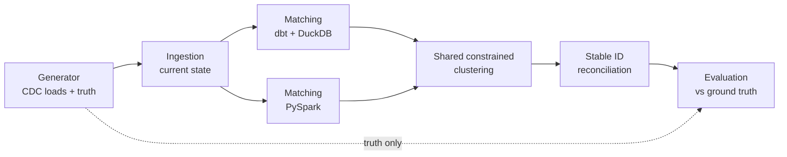

# Person Matching Pipeline

<!-- CI badge goes here once the GitHub repository exists. -->

> **Status: under construction.** Build phases 1–3 of 8 are complete: repository skeleton,
> configuration, reference data, the synthetic data generator, and CDC ingestion. Results and the full quickstart arrive in later phases;
> see [build phases](docs/DESIGN.md#17-build-phases).

**The problem.** The same person shows up in many source systems under slightly
different identities: a typo in the SSN, a nickname, a married name, a date of birth
with month and day swapped. Some look-alikes really are different people, such as
twins, a father and son, or a fraudster using a stolen SSN. Merging them by mistake
can put one patient's allergies on another patient's chart.

**The approach.** This project builds a rule-based, fully automated person matching
pipeline. It is designed so that every decision can be explained and measured:

- A **synthetic data generator** produces incremental CDC loads with known ground
  truth and 60 deliberately exaggerated edge cases
  ([catalog](docs/DATA_GENERATION.md)).
- An **ingestion layer** turns raw CDC events into a clean current-state table.
- **Matching runs twice**, in dbt on DuckDB and in PySpark, and the two must give
  identical results.
- **Tiered rules plus cannot-link blockers** follow one principle: *at most one
  imperfect field per automatic match; when uncertain, don't merge*.
- **Stable person IDs** change only when the data justifies it.
- **Evaluation against ground truth** reports pairwise precision/recall, outcomes per
  edge case, and ID churn.

**Headline results:** *coming in phase 6.*

## Pipeline



## Quickstart

Requirements: Python 3.11+, and Java 17+ for the PySpark implementation. No cloud
account is needed.

```bash
python -m venv .venv
source .venv/bin/activate          # Windows: .venv\Scripts\activate
make install                       # Windows without make: see below
make check-config
make generate                      # small preset: 13 monthly loads in a few seconds
make ingest                        # apply the CDC events to a current-state table
make test
```

Every `make` target wraps a Python command, so on Windows without `make` you can run:

```powershell
python -m pip install -r requirements-lock.txt
python -m pip install --no-deps -e .
python -m pipeline check-config
python -m pipeline generate --preset small
python -m pipeline ingest
python -m pytest
```

The full PySpark run is supported on Linux and macOS, and on Windows via WSL
([why](docs/DESIGN.md#18-decision-log), D-011).

## Repository layout

| Path | Contents |
|---|---|
| `docs/` | [Design specification](docs/DESIGN.md) (source of truth and decision log), data generation, matching rules, results |
| `config/` | `generator.yaml`, `matching.yaml`, and `reference/` data read by both implementations |
| `pipeline/` | Shared config and reference loaders, paths, CLI |
| `generator/` | Synthetic population and CDC event generator |
| `ingestion/` | CDC events to current state |
| `standardization/` | Python reference implementation of standardization |
| `matching_dbt/` | dbt project (DuckDB) |
| `matching_spark/` | PySpark implementation |
| `clustering/` | Shared constrained clustering and stable ID reconciliation |
| `evaluation/` | Metrics against ground truth (the only pipeline package that may read it) |
| `tests/` | Unit, scenario, parity, idempotency and determinism tests |

## Key design decisions

Each decision links to its full reasoning in the [decision log](docs/DESIGN.md#18-decision-log).

- **No human review queue.** Uncertain pairs become a no-match with a reason code (D-001, D-002).
- **Exact SSN + exact DOB need only one strong name**, so marriages and legal name changes still match (D-003).
- **Full rematch every load**, with ID reconciliation keeping person IDs stable (D-004, D-005).
- **One shared Python implementation** for clustering and string similarity, so dbt and Spark cannot disagree (D-006, D-009).
- **Conservative by default**, because in healthcare a false merge costs more than a duplicate (D-007).

## Results

*Coming in phases 6 and 8.*

## Known limitations

Some cases cannot be solved with five fields: full identity copies, unrelated people
with identical values, an SSN replacement combined with name changes, simultaneous
first- and last-name changes, and mononyms. Each is generated and measured, and its
real impact will be reported here.

## Example queries

*Coming in phase 5.*

## License

[MIT](LICENSE). All data is synthetic; no real people or SSNs appear anywhere in
this repository.
