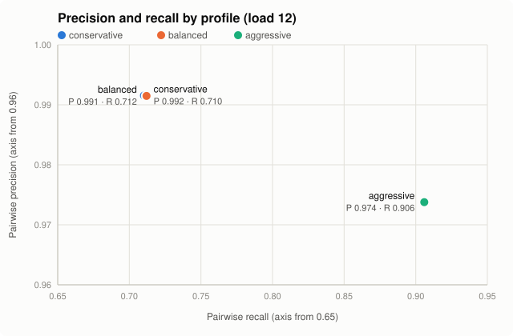

# Results

<!-- Generated by `python -m pipeline results` from the evaluation outputs. Do not edit by hand. -->

The edge case rates are deliberately exaggerated (D-008), so these numbers describe behaviour under stress. They are not a forecast of accuracy on production data. Definitions are in [DESIGN.md section 14](DESIGN.md#14-evaluation) and D-043.

## The run

- Generated data: preset **medium**, seed 42, 13 loads (2025-01-01 to 2026-01-01).
- Matching engine: dbt. Final load: 12, 127,996 live records, 88,236 true same-person pairs.
- Each profile was matched load by load from load 0 and scored against the truth in effect at each load.

## Engine parity

Every output table of every load was compared row for row between the dbt and PySpark runs (`python -m pipeline compare-engines`).

| Profile | Loads | Tables | Rows | Result |
| --- | ---: | ---: | ---: | --- |
| conservative | 0-12 | 117 | 9,082,428 | identical |
| balanced | 0-12 | 117 | 9,082,034 | identical |
| aggressive | 0-12 | 117 | 9,081,133 | identical |

## Summary by profile

Final load. Precision and recall are pairwise over all pairs of live records. A *false-merge record* has at least one record of another person in its cluster; a *missed-match record* has no wrong records but is missing at least one of its own. ID churn is the mean share of records, live in two consecutive loads, whose person ID changed.

| Profile | Precision | Recall | F1 | False pairs | False-merge records | Missed-match records | ID churn per load |
| --- | ---: | ---: | ---: | ---: | ---: | ---: | ---: |
| **conservative** | 0.9916 | 0.7102 | 0.8276 | 534 | 788 | 24,454 | 0.12% |
| balanced | 0.9915 | 0.7120 | 0.8288 | 540 | 797 | 24,329 | 0.12% |
| aggressive | 0.9738 | 0.9060 | 0.9386 | 2,153 | 2,982 | 9,604 | 0.08% |

## Where pairs are won and lost

Blocking decides which pairs are compared; pair decisions are the tier and blocker rules on each compared pair; clustering then adds pairs joined through other records and removes joins that would put a blocked pair together. Final load.

| Stage | conservative | balanced | aggressive |
| --- | ---: | ---: | ---: |
| Pairs compared | 449,475 | 449,475 | 449,475 |
| Blocking recall (true pairs compared) | 0.9750 | 0.9750 | 0.9750 |
| Pair decisions: precision | 0.9916 | 0.9914 | 0.9771 |
| Pair decisions: recall | 0.7011 | 0.7033 | 0.8864 |
| Clusters: precision | 0.9916 | 0.9915 | 0.9738 |
| Clusters: recall | 0.7102 | 0.7120 | 0.9060 |

## Reason codes against truth (conservative)

Every compared pair gets one reason code. A same-person pair under a blocker or `NO_MATCH_INSUFFICIENT` is a missed match; a different-person pair under a tier that matches is a false match. `SKIPPED_TRANSITIVITY` counts matches clustering refused.

| Reason code | Pairs | Same person | Different people | Same person % |
| --- | ---: | ---: | ---: | ---: |
| `NO_MATCH_INSUFFICIENT` | 360,572 | 8,826 | 351,746 | 2.4% |
| `TIER_1_EXACT_IDS` | 52,888 | 52,541 | 347 | 99.3% |
| `TIER_4_NO_SSN` | 16,467 | 15,231 | 1,236 | 92.5% |
| `BLOCKED_TWINS` | 6,868 | 87 | 6,781 | 1.3% |
| `TIER_2_SSN_NEAR` | 5,365 | 5,243 | 122 | 97.7% |
| `TIER_3_DOB_NEAR` | 4,138 | 4,081 | 57 | 98.6% |
| `BLOCKED_GENERATIONAL` | 2,645 | 0 | 2,645 | 0.0% |
| `BLOCKED_SSN_CONFLICT` | 506 | 13 | 493 | 2.6% |
| `SKIPPED_TRANSITIVITY` | 268 | 259 | 9 | 96.6% |
| `BLOCKED_SUFFIX` | 26 | 6 | 20 | 23.1% |

## Outcomes per edge case (conservative)

Final load. *Records* are live records tagged with the case at any point in their life. Records **with a true partner** (another live record of the same person) are split into correct / missed match / false merge. Records **without** one can only go wrong by a false merge. Pair precision and recall count every pair involving a tagged record. Expected outcomes are from the [catalog](DATA_GENERATION.md).

Cases compound and a person's other records carry their own cases, so a tagged record's outcome also depends on them. Compare each row with the *all records* baseline at the top of each table rather than with 100%.

### Identifier errors and placeholders

| Code | Records | With partner: correct / missed / false merge | Without partner: false merge | Pair precision | Pair recall | Expected |
| --- | ---: | ---: | ---: | ---: | ---: | --- |
| *all records* | 127,996 | 53,903: 54.0% / 45.4% / 0.6% | 74,093: 0.6% | 0.992 | 0.710 | Baseline for comparison |
| `SSN_TYPO_SUB` | 3,408 | 1,490: 51.6% / 47.9% / 0.5% | 1,918: 0.5% | 0.994 | 0.710 | Tier 2 match |
| `SSN_TYPO_TRANSPOSE` | 2,315 | 987: 51.3% / 47.9% / 0.8% | 1,328: 0.4% | 0.992 | 0.704 | Tier 2 match |
| `SSN_NUMERIC_CORRUPT` | 2,192 | 960: 60.3% / 38.9% / 0.8% | 1,232: 0.7% | 0.988 | 0.793 | Fixed by standardization, then normal tiers |
| `SSN_PLACEHOLDER` | 2,144 | 851: 0.0% / 100.0% / 0.0% | 1,293: 0.0% | – | 0.000 | Treated as missing |
| `SSN_TEMP_ITIN` | 1,001 | 419: 0.0% / 100.0% / 0.0% | 582: 0.0% | – | 0.000 | Treated as missing |
| `SSN_DELAYED` | 2,073 | 833: 59.7% / 39.7% / 0.6% | 1,240: 0.7% | 0.992 | 0.803 | Same source record updates; matching uses new SSN |
| `SSN_CORRECTED` | 1,057 | 443: 61.4% / 37.7% / 0.9% | 614: 1.0% | 0.990 | 0.819 | Rematch reflects corrected value |
| `DOB_TYPO_DIGIT` | 2,527 | 1,033: 50.0% / 49.4% / 0.7% | 1,494: 0.3% | 0.994 | 0.676 | Tier 3 match |
| `DOB_MONTH_DAY_SWAP` | 881 | 382: 52.4% / 47.1% / 0.5% | 499: 0.2% | 0.996 | 0.684 | Tier 3 match |
| `DOB_YEAR_OFF_ONE` | 1,290 | 552: 47.3% / 52.2% / 0.5% | 738: 0.1% | 0.987 | 0.667 | Tier 3 match |
| `DOB_LEAP_DAY` | 625 | 269: 36.4% / 63.6% / 0.0% | 356: 0.0% | 1.000 | 0.686 | Tier 3 match |
| `DOB_PLACEHOLDER` | 1,194 | 490: 0.0% / 100.0% / 0.0% | 704: 0.0% | – | 0.000 | Treated as missing |
| `DOB_JAN_FIRST` | 1,164 | 478: 1.7% / 98.3% / 0.0% | 686: 0.0% | 1.000 | 0.041 | Kept, flagged weak |
| `DOB_TWO_DIGIT_YEAR` | 900 | 369: 0.0% / 100.0% / 0.0% | 531: 0.0% | – | 0.000 | Future DOB treated as missing |
| `DOB_YEAR_ONLY` | 563 | 229: 0.0% / 100.0% / 0.0% | 334: 0.0% | – | 0.000 | Treated as missing |
| `DOB_CORRECTED` | 609 | 222: 56.8% / 43.2% / 0.0% | 387: 0.3% | 0.996 | 0.719 | Rematch reflects corrected value |

### Name variation

| Code | Records | With partner: correct / missed / false merge | Without partner: false merge | Pair precision | Pair recall | Expected |
| --- | ---: | ---: | ---: | ---: | ---: | --- |
| *all records* | 127,996 | 53,903: 54.0% / 45.4% / 0.6% | 74,093: 0.6% | 0.992 | 0.710 | Baseline for comparison |
| `NAME_TYPO` | 5,038 | 2,138: 50.4% / 49.2% / 0.5% | 2,900: 0.7% | 0.992 | 0.683 | Strong name via fuzzy |
| `NAME_NICKNAME` | 8,281 | 3,540: 54.2% / 45.1% / 0.6% | 4,741: 0.4% | 0.993 | 0.708 | Strong name via nickname table |
| `NAME_PHONETIC` | 7,221 | 3,029: 55.0% / 44.1% / 0.9% | 4,192: 0.7% | 0.990 | 0.714 | Strong name via phonetic |
| `NAME_TRANSLITERATION` | 3,584 | 1,543: 53.4% / 46.3% / 0.3% | 2,041: 0.9% | 0.993 | 0.701 | Strong name via variant table |
| `NAME_SWAPPED` | 1,345 | 548: 46.2% / 53.5% / 0.4% | 797: 0.4% | 0.996 | 0.676 | Swapped level; matches per tiers |
| `NAME_FAMILY_FIRST` | 1,697 | 738: 56.2% / 43.4% / 0.4% | 959: 0.5% | 0.994 | 0.725 | Swapped level |
| `NAME_MIDDLE_IN_FIRST` | 7,482 | 3,159: 54.3% / 45.3% / 0.4% | 4,323: 0.6% | 0.992 | 0.708 | Token match |
| `NAME_CONCATENATED` | 2,624 | 1,087: 53.0% / 46.6% / 0.4% | 1,537: 0.3% | 0.995 | 0.672 | Space-removed comparison |
| `NAME_INITIAL` | 1,133 | 443: 43.8% / 55.8% / 0.5% | 690: 0.0% | 0.998 | 0.625 | Weak name |
| `NAME_TRUNCATED` | 957 | 410: 52.4% / 47.1% / 0.5% | 547: 0.4% | 0.996 | 0.724 | Prefix rule (>= 6 chars) |
| `NAME_COMPOUND_SURNAME` | 2,695 | 1,129: 51.0% / 48.7% / 0.3% | 1,566: 0.6% | 0.993 | 0.707 | Token match |
| `NAME_PARTICLE` | 1,503 | 632: 54.0% / 45.6% / 0.5% | 871: 0.3% | 0.994 | 0.701 | Particle-stripped comparison |
| `NAME_UNICODE` | 7,975 | 3,393: 55.1% / 44.1% / 0.8% | 4,582: 0.8% | 0.991 | 0.720 | NFC normalize, strip accents |
| `NAME_SUFFIX_IN_LAST` | 861 | 359: 54.6% / 44.8% / 0.6% | 502: 0.2% | 0.995 | 0.703 | Suffix extracted in standardization |
| `NAME_PLACEHOLDER` | 1,287 | 538: 34.6% / 64.7% / 0.7% | 749: 0.3% | 0.990 | 0.454 | Treated as missing |
| `NAME_MONONYM` | 278 | 140: 27.9% / 72.1% / 0.0% | 138: 0.0% | 1.000 | 0.568 | Placeholder handling; documented limitation |

### Life and legal events

| Code | Records | With partner: correct / missed / false merge | Without partner: false merge | Pair precision | Pair recall | Expected |
| --- | ---: | ---: | ---: | ---: | ---: | --- |
| *all records* | 127,996 | 53,903: 54.0% / 45.4% / 0.6% | 74,093: 0.6% | 0.992 | 0.710 | Baseline for comparison |
| `MARRIAGE` | 3,091 | 1,350: 56.4% / 43.4% / 0.2% | 1,741: 0.3% | 0.988 | 0.706 | Tier 1 (one strong name) |
| `DIVORCE_RESTORE` | 838 | 374: 54.5% / 44.7% / 0.8% | 464: 0.4% | 0.984 | 0.610 | Tier 1 |
| `LEGAL_FIRST_NAME_CHANGE` | 682 | 321: 54.5% / 45.5% / 0.0% | 361: 0.3% | 0.998 | 0.745 | Tier 1 (one strong name) |
| `ADOPTION_NAME_CHANGE` | 239 | 106: 58.5% / 41.5% / 0.0% | 133: 1.5% | 0.982 | 0.830 | Tier 1 |
| `GENDER_CHANGE_OR_ERROR` | 2,465 | 1,028: 54.5% / 44.5% / 1.1% | 1,437: 0.7% | 0.988 | 0.741 | Ignored as evidence |
| `FULL_NAME_CHANGE` | 289 | 122: 51.6% / 48.4% / 0.0% | 167: 0.0% | 1.000 | 0.746 | Known limitation: no match |
| `SSN_REPLACEMENT` | 706 | 701: 0.0% / 99.1% / 0.9% | 5: 0.0% | 0.992 | 0.460 | Known limitation unless names and DOB carry it |

### Family and look-alike cases

| Code | Records | With partner: correct / missed / false merge | Without partner: false merge | Pair precision | Pair recall | Expected |
| --- | ---: | ---: | ---: | ---: | ---: | --- |
| *all records* | 127,996 | 53,903: 54.0% / 45.4% / 0.6% | 74,093: 0.6% | 0.992 | 0.710 | Baseline for comparison |
| `TWINS` | 4,859 | 2,045: 53.5% / 45.8% / 0.6% | 2,814: 1.3% | 0.984 | 0.684 | BLOCKED_TWINS |
| `MULTIPLES` | 1,336 | 501: 53.1% / 44.9% / 2.0% | 835: 1.8% | 0.974 | 0.741 | BLOCKED_TWINS |
| `NEWBORN_PARENT_SSN` | 1,015 | 490: 48.6% / 51.4% / 0.0% | 525: 0.0% | 1.000 | 0.704 | BLOCKED_GENERATIONAL |
| `NEWBORN_PLACEHOLDER` | 776 | 349: 41.0% / 59.0% / 0.0% | 427: 0.2% | 0.998 | 0.653 | Placeholder name handling |
| `JR_SR` | 744 | 325: 56.6% / 43.4% / 0.0% | 419: 0.0% | 1.000 | 0.759 | BLOCKED_SUFFIX or BLOCKED_GENERATIONAL |
| `COMMON_NAME_SAME_DOB` | 2,728 | 1,110: 13.2% / 86.2% / 0.6% | 1,618: 0.1% | 0.980 | 0.231 | No SSN: Tier 4 no-match (conservative) |
| `IDENTICAL_STRANGERS` | 279 | 150: 2.0% / 19.3% / 78.7% | 129: 68.2% | 0.588 | 0.700 | Known limitation |

### Shared and copied identities

| Code | Records | With partner: correct / missed / false merge | Without partner: false merge | Pair precision | Pair recall | Expected |
| --- | ---: | ---: | ---: | ---: | ---: | --- |
| *all records* | 127,996 | 53,903: 54.0% / 45.4% / 0.6% | 74,093: 0.6% | 0.992 | 0.710 | Baseline for comparison |
| `SSN_SHARED_FRAUD` | 1,250 | 558: 55.2% / 44.8% / 0.0% | 692: 0.3% | 0.997 | 0.719 | BLOCKED_SSN_CONFLICT |
| `SSN_SHARED_MANY` | 680 | 277: 45.5% / 54.5% / 0.0% | 403: 0.2% | 0.997 | 0.620 | BLOCKED_SSN_CONFLICT; oversized SSN block monitored |
| `SYNTHETIC_IDENTITY` | 733 | 334: 59.9% / 40.1% / 0.0% | 399: 0.3% | 0.997 | 0.683 | BLOCKED_SSN_CONFLICT where detectable |
| `FULL_IDENTITY_COPY` | 249 | 96: 5.2% / 19.8% / 75.0% | 153: 74.5% | 0.605 | 0.695 | Known limitation |
| `NEAR_MATCH_ATTACK` | 472 | 168: 4.8% / 23.2% / 72.0% | 304: 68.4% | 0.434 | 0.658 | Measured; conservative thresholds limit exposure |

### Source system and pipeline

| Code | Records | With partner: correct / missed / false merge | Without partner: false merge | Pair precision | Pair recall | Expected |
| --- | ---: | ---: | ---: | ---: | ---: | --- |
| *all records* | 127,996 | 53,903: 54.0% / 45.4% / 0.6% | 74,093: 0.6% | 0.992 | 0.710 | Baseline for comparison |
| `MIGRATION_REFORMAT` | 60,263 | 25,463: 52.1% / 47.3% / 0.6% | 34,800: 0.6% | 0.991 | 0.694 | Standardization + normal tiers |
| `SOURCE_ID_CHANGE` | 4,380 | 1,889: 56.0% / 42.8% / 1.2% | 2,491: 0.5% | 0.990 | 0.739 | Matching on attributes, not source IDs |
| `SOURCE_ID_REUSE` | 418 | 180: 57.2% / 42.8% / 0.0% | 238: 1.3% | 0.990 | 0.735 | Ingestion treats post-delete insert as a new record version; matching decides |
| `DUPLICATE_DELIVERY` | 3,990 | 1,648: 51.6% / 48.0% / 0.4% | 2,342: 0.6% | 0.991 | 0.699 | Deduplicated by event_id |
| `OUT_OF_ORDER` | 1,675 | 657: 56.8% / 42.6% / 0.6% | 1,018: 0.5% | 0.994 | 0.748 | Ordered by sequence_no |
| `LATE_AFTER_DELETE` | 0 | – | – | – | – | Ignored; record stays deleted |
| `COLUMN_SHIFT` | 75 | 30: 60.0% / 40.0% / 0.0% | 45: 0.0% | 1.000 | 0.700 | Rejected with reason |
| `ENCODING_CORRUPTION` | 1,052 | 458: 53.3% / 46.5% / 0.2% | 594: 0.7% | 0.995 | 0.693 | Rejected or flagged, per validation rules |
| `BULK_REPLAY` | 4,465 | 1,902: 52.3% / 47.3% / 0.5% | 2,563: 0.7% | 0.993 | 0.705 | Idempotent; no change |

## False-merge records by profile

Edge cases with at least one tagged record in a cluster with another person's records, in any profile. Final load.

| Code | conservative | balanced | aggressive |
| --- | ---: | ---: | ---: |
| `SSN_TYPO_SUB` | 16 | 16 | 40 |
| `SSN_TYPO_TRANSPOSE` | 13 | 14 | 35 |
| `SSN_NUMERIC_CORRUPT` | 17 | 17 | 35 |
| `SSN_PLACEHOLDER` | 0 | 0 | 44 |
| `SSN_TEMP_ITIN` | 0 | 0 | 25 |
| `SSN_DELAYED` | 14 | 14 | 31 |
| `SSN_CORRECTED` | 10 | 10 | 27 |
| `DOB_TYPO_DIGIT` | 11 | 11 | 21 |
| `DOB_MONTH_DAY_SWAP` | 3 | 3 | 11 |
| `DOB_YEAR_OFF_ONE` | 4 | 4 | 12 |
| `DOB_LEAP_DAY` | 0 | 0 | 6 |
| `DOB_CORRECTED` | 1 | 1 | 11 |
| `NAME_TYPO` | 29 | 32 | 123 |
| `NAME_NICKNAME` | 44 | 44 | 140 |
| `NAME_PHONETIC` | 57 | 57 | 200 |
| `NAME_TRANSLITERATION` | 23 | 23 | 142 |
| `NAME_SWAPPED` | 5 | 5 | 30 |
| `NAME_FAMILY_FIRST` | 8 | 8 | 76 |
| `NAME_MIDDLE_IN_FIRST` | 37 | 38 | 101 |
| `NAME_CONCATENATED` | 9 | 9 | 30 |
| `NAME_INITIAL` | 2 | 2 | 6 |
| `NAME_TRUNCATED` | 4 | 4 | 16 |
| `NAME_COMPOUND_SURNAME` | 12 | 13 | 22 |
| `NAME_PARTICLE` | 6 | 6 | 17 |
| `NAME_UNICODE` | 63 | 64 | 184 |
| `NAME_SUFFIX_IN_LAST` | 3 | 3 | 21 |
| `NAME_PLACEHOLDER` | 6 | 7 | 8 |
| `MARRIAGE` | 9 | 9 | 38 |
| `DIVORCE_RESTORE` | 5 | 5 | 34 |
| `LEGAL_FIRST_NAME_CHANGE` | 1 | 1 | 4 |
| `ADOPTION_NAME_CHANGE` | 2 | 2 | 2 |
| `GENDER_CHANGE_OR_ERROR` | 21 | 21 | 57 |
| `SSN_REPLACEMENT` | 6 | 6 | 13 |
| `TWINS` | 50 | 53 | 93 |
| `MULTIPLES` | 25 | 28 | 55 |
| `NEWBORN_PARENT_SSN` | 0 | 0 | 3 |
| `NEWBORN_PLACEHOLDER` | 1 | 1 | 12 |
| `JR_SR` | 0 | 0 | 3 |
| `COMMON_NAME_SAME_DOB` | 9 | 9 | 1,814 |
| `IDENTICAL_STRANGERS` | 206 | 206 | 243 |
| `SSN_SHARED_FRAUD` | 2 | 2 | 4 |
| `SSN_SHARED_MANY` | 1 | 1 | 4 |
| `SYNTHETIC_IDENTITY` | 1 | 1 | 134 |
| `FULL_IDENTITY_COPY` | 186 | 188 | 228 |
| `NEAR_MATCH_ATTACK` | 329 | 330 | 389 |
| `MIGRATION_REFORMAT` | 358 | 363 | 1,412 |
| `SOURCE_ID_CHANGE` | 35 | 35 | 117 |
| `SOURCE_ID_REUSE` | 3 | 3 | 12 |
| `DUPLICATE_DELIVERY` | 21 | 21 | 96 |
| `OUT_OF_ORDER` | 9 | 9 | 30 |
| `COLUMN_SHIFT` | 0 | 0 | 2 |
| `ENCODING_CORRUPTION` | 5 | 5 | 21 |
| `BULK_REPLAY` | 26 | 26 | 103 |

## Entity instability (conservative)

For each record live in a load and the one before, did its person ID change? A change is *corrective* when the record's own pairwise F1 against truth improved, *degrading* when it fell, and *neutral* otherwise.

| Load | Records in both | ID changed | Corrective | Degrading | Neutral | Churn |
| --- | ---: | ---: | ---: | ---: | ---: | ---: |
| 1 | 98,946 | 95 | 88 | 7 | 0 | 0.10% |
| 2 | 101,196 | 114 | 101 | 13 | 0 | 0.11% |
| 3 | 104,425 | 142 | 134 | 8 | 0 | 0.14% |
| 4 | 107,462 | 83 | 77 | 6 | 0 | 0.08% |
| 5 | 108,729 | 104 | 93 | 11 | 0 | 0.10% |
| 6 | 110,509 | 157 | 136 | 21 | 0 | 0.14% |
| 7 | 113,343 | 135 | 125 | 10 | 0 | 0.12% |
| 8 | 115,783 | 189 | 183 | 6 | 0 | 0.16% |
| 9 | 118,239 | 129 | 110 | 19 | 0 | 0.11% |
| 10 | 119,909 | 127 | 114 | 13 | 0 | 0.11% |
| 11 | 118,215 | 158 | 149 | 9 | 0 | 0.13% |
| 12 | 125,554 | 258 | 252 | 5 | 1 | 0.21% |

## Known limitations, measured (conservative)

These cases cannot be solved with five fields (DESIGN.md section 16). Columns as in the edge case tables.

| Code | Records | With partner: correct / missed / false merge | Without partner: false merge | Pair precision | Pair recall |
| --- | ---: | ---: | ---: | ---: | ---: |
| `FULL_IDENTITY_COPY` | 249 | 96: 5.2% / 19.8% / 75.0% | 153: 74.5% | 0.605 | 0.695 |
| `IDENTICAL_STRANGERS` | 279 | 150: 2.0% / 19.3% / 78.7% | 129: 68.2% | 0.588 | 0.700 |
| `SSN_REPLACEMENT` | 706 | 701: 0.0% / 99.1% / 0.9% | 5: 0.0% | 0.992 | 0.460 |
| `FULL_NAME_CHANGE` | 289 | 122: 51.6% / 48.4% / 0.0% | 167: 0.0% | 1.000 | 0.746 |
| `NAME_MONONYM` | 278 | 140: 27.9% / 72.1% / 0.0% | 138: 0.0% | 1.000 | 0.568 |
